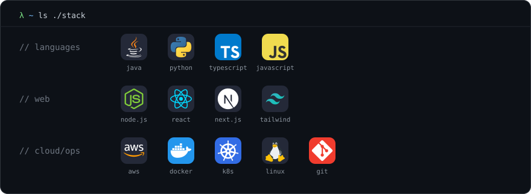
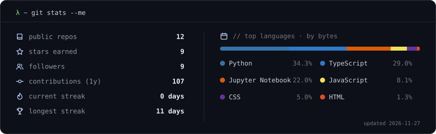

<div align="center">



<br/>

<code><a href="https://portfolio-harishrams.vercel.app/">portfolio</a></code> &nbsp;
<code><a href="https://linkedin.com/in/harish-ram-s">linkedin</a></code> &nbsp;
<code><a href="https://leetcode.com">leetcode</a></code> &nbsp;
<code><a href="https://hackerrank.com">hackerrank</a></code> &nbsp;


</div>

<br/>

### `~/about`

```yaml
name:      Harish Ram S
role:      Pre-final year CSE @ Chennai Institute of Technology
building:  at the intersection of AI, distributed systems & cloud infra
currently: obsessed with Agentic AI and Kubernetes
believes:  ship small, measure, then scale
```

### `~/stack`



### `~/projects`

<table>
  <tr>
    <td width="50%" valign="top">
      <a href="https://github.com/harish-ram247/Kavrix"><b>kavrix</b></a> <sub><code>python</code> <code>yolov8</code></sub><br/>
      <sub>AI for public safety: drone feeds → crowd-crush risk scores, privacy-first face matching, and SHA-256 hash-chained, signed evidence.</sub>
    </td>
    <td width="50%" valign="top">
      <a href="https://github.com/harish-ram247/Expense_Tracker"><b>spendwise</b></a> <sub><code>react native</code> <code>typescript</code></sub><br/>
      <sub>Offline-first expense tracker for Android — budgets, insights and trends, all in on-device SQLite. No account, no server.</sub>
    </td>
  </tr>
  <tr>
    <td width="50%" valign="top">
      <a href="https://github.com/harish-ram247/TRACE"><b>trace</b></a> <sub><code>python</code> <code>rag</code> <code>docker</code></sub><br/>
      <sub>Temporal Retrieval with Attributed Claim Evidence: a RAG backend that knows <i>when</i> each passage was true and checks every claim against a source valid on the date asked.</sub>
    </td>
    <td width="50%" valign="top">
      <a href="https://github.com/harish-ram247/My-Portfolio"><b>portfolio</b></a> <sub><code>next.js</code> <code>gsap</code> <code>tailwind</code></sub><br/>
      <sub>My personal site: Next.js 15 + React 19 with GSAP and Framer Motion animation. <a href="https://portfolio-harishrams.vercel.app/">Live ↗</a></sub>
    </td>
  </tr>
</table>

### `~/stats`





<br/>

<div align="center">
  <sub><code>λ ~ exit 0</code> &nbsp;·&nbsp; thanks for stopping by</sub>
</div>
